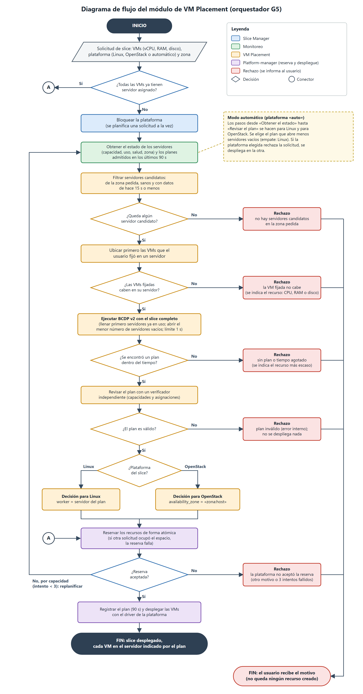

# TEL141 — Laboratorio 7: Informe previo — Grupo 5

**Tema:** Módulo de VM Placement y pruebas unitarias · **Semestre:** 2026-2 · **Proyecto:** PUCP Private Cloud Orchestrator

> **Cómo leer este informe.** El módulo de VM Placement de G5 ya está implementado (microservicio `vm-placement`),
> integrado al Slice Manager y probado de punta a punta en ambos clústeres (evidencia MS-17, 15/11/2026). Cada
> respuesta distingue tres niveles: **[Implementado]** (código en la rama `fase2`, con prueba), **[Probado en el
> clúster]** (evidencia real) y **[Diseño]** (propuesta aún no implementada). Las rutas citadas son del repositorio.

---

## ACTIVIDAD PREVIA: túneles SSH desde Localhost hacia el Head Node (0 ptos)

El head node de OpenStack se alcanza por el gateway de la topología de G5 (`10.20.11.245`, puerto `5821`, según la
tabla de accesos de la guía del LAB6). Cada túnel publica en `localhost` un servicio del controlador:

| Puerto local | Puerto en el head node | Servicio | Uso en el módulo de placement |
|---|---|---|---|
| 55000 | 5000 | Keystone | Token para consultar Nova |
| 58774 | 8774 | Nova (compute) | `os-hypervisors` (capacidad y uso), `os-aggregates` (zonas), crear VMs con zona/host |
| 58778 | 8778 | Placement API | Inventario y asignaciones por proveedor de recursos (consulta) |
| 59696 | 9696 | Neutron | Redes, puertos y grupos de seguridad del slice |
| 59292 | 9292 | Glance | Imágenes |
| 56080 | 6080 | noVNC | Consola de las VMs |
| 50080 | 80 | Horizon | Verificación visual (proyecto y host de cada VM) |

```bash
ssh -NL 55000:127.0.0.1:5000 ubuntu@10.20.11.245 -p 5821
ssh -NL 58774:127.0.0.1:8774 ubuntu@10.20.11.245 -p 5821
ssh -NL 58778:127.0.0.1:8778 ubuntu@10.20.11.245 -p 5821
ssh -NL 59696:127.0.0.1:9696 ubuntu@10.20.11.245 -p 5821
ssh -NL 59292:127.0.0.1:9292 ubuntu@10.20.11.245 -p 5821
ssh -NL 56080:127.0.0.1:6080 ubuntu@10.20.11.245 -p 5821
ssh -NL 50080:127.0.0.1:80   ubuntu@10.20.11.245 -p 5821
```

Equivalente en un solo proceso: `ssh -N -L 55000:127.0.0.1:5000 -L 58774:127.0.0.1:8774 -L 58778:127.0.0.1:8778 -L 59696:127.0.0.1:9696 -L 59292:127.0.0.1:9292 -L 56080:127.0.0.1:6080 -L 50080:127.0.0.1:80 ubuntu@10.20.11.245 -p 5821`.

**[Implementado]** En el despliegue del orquestador estos túneles no los abre una persona: el contenedor `os-tunnel`
(`services/os-tunnel/entrypoint.sh`) mantiene `ssh -N -L 0.0.0.0:<p>:<controller>:<p>` para 5000, 8774, 9696, 9292 y
6080, con `ExitOnForwardFailure` y reinicio automático, visibles solo en la red interna de Docker. El 8778
(Placement API) aún no está habilitado en la llave del gateway (`permitopen`); el placement de G5 no lo necesita
porque toma el inventario de `os-hypervisors`.

---

## 1) INTRODUCCIÓN (0.5 ptos)

### a) Necesidad de un módulo de VM Placement

Un slice es un conjunto de VMs que deben quedar distribuidas sobre servidores físicos con capacidad finita (en
nuestro clúster: 3 servidores Linux de 4 CPU / 3,8 GB de RAM / ~9,7 GB de disco y 3 computes OpenStack de
4 vCPU / 3,9 GB / 9 GB). El módulo resuelve **a qué servidor va cada VM** de modo que:

- ninguna dimensión de ningún servidor se exceda (vCPU comprometidas, CPU real, RAM, disco);
- se respeten las restricciones del usuario (zona de disponibilidad, VMs fijadas a mano);
- el slice se admita **completo o se rechace con un motivo**, sin quedar desplegado a medias;
- se use la menor cantidad posible de servidores nuevos (consolidación).

**Consecuencias de un placement deficiente**, varias observadas en nuestro propio clúster:

| Problema | Efecto |
|---|---|
| Sobrecompromiso de CPU o RAM | Contención de CPU, latencia y, en RAM, *swapping* o el OOM killer matando QEMU. |
| Disco sobreasignado | Un qcow2 que crece llena el disco del servidor y se pausan todas sus VMs. En el clúster Linux una Ubuntu de 4 GB necesita ≈ 8 GB reservables y hay ≈ 6,5 GB libres (MS-18): sin control, el fallo aparece a mitad del despliegue. |
| Fragmentación | Hay capacidad total suficiente pero repartida en trozos que no alojan ninguna VM: se rechazan slices que sí cabían. La heurística BFD del HLD rechazó 170 de 360 instancias factibles. |
| Hosts encendidos de más | Más consumo y menos capacidad libre para slices grandes. |
| Decisión delegada a ciegas | Sin host forzado, Nova elige con sus propios ratios (16 : 1,5 : 1) y criterios, distintos de los de G5. |
| Condiciones de carrera | Dos slices simultáneos que ven la misma capacidad libre y la consumen dos veces. |

### b) Objetivos funcionales del módulo e impacto dentro del orquestador

**Decisiones que automatiza [Implementado]:**

1. **Filtrado** de candidatos: zona pedida, salud del host, telemetría vigente (≤ 15 s).
2. **Asignación** `{vm → host}` de todo el slice con BCDP v2, minimizando los hosts nuevos que se ocupan.
3. **Admisión o rechazo** con estado (`PLAN_FOUND`, `HEURISTIC_NO_PLAN`, `PLANNING_TIMEOUT`, `INVALID_OR_ERROR`) y
   motivo legible (p. ej. «RAM insuficiente: se piden 3072 y quedan 2048 libres»).
4. **Respeto de VMs fijadas** por el usuario (paso 3 del Ex2: «2 VMs en server2»), que se descuentan primero.
5. **Validación** independiente de todo plan antes de responder.
6. **Elección de la plataforma** cuando el usuario pide modo automático: se planifica en Linux y en OpenStack y se
   despliega donde ocupe menos servidores nuevos (ver 4 b).

**Ventajas de un módulo unificado para Linux y OpenStack:**

- **Una sola función objetivo y unas mismas reglas**: el mismo slice recibe un plan comparable en ambos
  backends; las pruebas se escriben una vez.
- **Un modelo de host normalizado** (CPU, RAM, disco, uso, zona, salud): las diferencias de cada plataforma quedan
  en el adaptador de inventario (microservicio de monitoreo), no en el algoritmo.
- **Control del orquestador**: en OpenStack el host elegido se fuerza en Nova; así la decisión es de G5 y no del
  scheduler de OpenStack, y el comportamiento es el mismo que en Linux, donde no hay scheduler.
- **Desacople**: es un servicio sin estado; se puede cambiar la heurística (BFD → BCDP v2 se hizo así) sin tocar el
  Slice Manager ni los drivers.

---

## 2) ANÁLISIS DEL CLÚSTER LINUX (0.5 ptos)

### a) Recursos a considerar y factores de discriminación

**[Implementado]** Cada host se describe en **cuatro dimensiones** y cada una tiene su límite
(`services/vm-placement/src/g5_placement/planner.py`, `host_vectors`):

| Dimensión | Capacidad | Uso actual | Demanda de la VM |
|---|---|---|---|
| vCPU nominal | `ratio_cpu (2,0) × núcleos`, acotado por `vcpus_max` del servidor | vCPU comprometidas | `vcpus` |
| CPU real (centésimas) | `85 % × 100 × núcleos` | CPU medida del host | CPU prevista; sin perfil, `100 × vcpus` |
| RAM (MB) | RAM neta (ratio 1,0; ya descontada la reserva del host) | RAM comprometida | `memory_mb` |
| Disco (MB) | disco neto reservable (ratio 1,0) | disco comprometido | `disk_gb × 1024` |

**Factores que discriminan** (filtros previos, `eligible`):

- **Zona de disponibilidad** pedida por el usuario.
- **Estado del nodo**: habilitado en el registro y con agente respondiendo (`healthy`).
- **Antigüedad de la telemetría**: más de 15 s → se descarta («telemetría vencida»).
- **Rol del nodo**: el gateway del slice y los nodos de gestión no son candidatos (no figuran como workers).
- **Ocupación** (`occupied`): no filtra, pero prioriza los hosts ya ocupados para no abrir nuevos.

Se separan **compromiso** (lo reservado por slices, sale del registro transaccional) y **consumo medido** (CPU
real). El compromiso protege RAM y disco, que no admiten sobreasignación; la CPU real permite compartir núcleos entre
cargas que no usan el 100 % todo el tiempo (ver 4 e).

### b) Recolección de la información desde los nodos físicos

**[Implementado y probado en el clúster]**

1. **Agente en cada servidor** (`g5/agent.py`, acción `metrics`, solo lectura): mide la CPU como incremento de
   `/proc/stat` en 1 s (centésimas de CPU), la CPU de cada proceso QEMU de G5, `MemAvailable` de `/proc/meminfo` y el
   disco libre del almacén de VMs.
2. **Platform-manager** (`GET /v1/metrics`): consulta en paralelo a todos los agentes por SSH a través del gateway y
   añade, por servidor, la **capacidad** (`config/cluster.json`) y lo **asignado** (tabla `allocations`, registro
   transaccional de reservas). Para OpenStack añade `os-hypervisors` y la zona de cada host (`os-aggregates`).
3. **Microservicio de monitoreo** (`services/monitoring`): muestrea `/v1/metrics` cada 10 s, normaliza al modelo de
   host del placement (`normalize.py`), guarda historial en SQLite y publica `GET /v1/monitoring/state` (estado actual
   con `age_s`) y `/v1/monitoring/history`. La web lo muestra en la página «Recursos».

Ejemplo real (15/11/2026): `server1 libre 6494 MB de 9749 | reservable 6 GB, asignado 0`.

### c) Estrategias de placement posibles

| Estrategia | Idea | Ventaja | Desventaja |
|---|---|---|---|
| Round-Robin | Turnos entre hosts | Trivial, reparte | Ignora capacidades; falla con VMs heterogéneas (era el reparto provisional del adaptador Linux antes de R4) |
| First-Fit | Primer host donde cabe | Rápido | Fragmenta; depende del orden |
| Best-Fit | Host que queda más lleno | Consolida | Deja huecos pequeños inútiles |
| Worst-Fit / spread | Host más libre | Equilibra carga | Ocupa todos los hosts; no consolida |
| FFD / BFD (decreasing) | Ordena VMs de mayor a menor y aplica First/Best-Fit | Mejor que sin ordenar | Una sola dimensión de orden; en 4 dimensiones falla mucho (BFD del HLD: 170/360 sin plan) |
| Producto punto (tipo Tetris) | Elige la VM cuya demanda se alinea con lo libre del host | Multidimensional | Codicioso, sin corrección posterior |
| **BCDP v2 (elegida)** | Llena host por host con producto punto, refina con intercambios, repara y elimina hosts | 1/360 sin plan, +0,05 hosts sobre el óptimo, 95 % óptimo | Más lento (≈ 170 ms en 240 VMs; límite de 1 s) |
| Solver exacto (CP-SAT) | Programación entera | Óptimo | Tiempo impredecible; usado solo como referencia |

La comparación se hizo contra CP-SAT en 360 instancias de 6 a 240 VMs y 3 a 40 hosts
(`vm-placement_md/G5_Documentacion_Ex1_Fase2_DETALLADA_Claude.md`, sección 2).

### d) Sin un componente central: evitar conflictos, optimizar y facilitar la orquestación

En Linux no hay un scheduler como el de Nova; G5 crea el equivalente con **un único escritor** del estado de
capacidad y **optimismo con verificación**:

1. **Reserva atómica en un solo lugar [Implementado].** El platform-manager es el único que escribe reservas: en una
   transacción SQLite comprueba que las VMs caben en `capacity` de cada servidor y las inserta en `allocations`. Si
   otro slice ganó el hueco, responde **409** y no queda nada a medias.
2. **Planificación serializada por proveedor [Implementado].** El Slice Manager planifica y envía bajo un candado por
   proveedor; si la reserva devuelve 409 por capacidad, vuelve a planificar (hasta 3 intentos).
3. **Registro de planes recientes [Implementado].** Como la telemetría puede tener hasta 10 s, los planes admitidos en
   los últimos 90 s se suman como compromiso al inventario antes de planificar (evita doble asignación entre dos
   peticiones seguidas).
4. **Verificación local en el agente [Implementado].** Antes de crear, el agente vuelve a comprobar CPU, memoria y
   disco reales del servidor (`prepare`); si no alcanzan, el slice falla y se compensa (MS-18: «Disco insuficiente…»,
   FAILED_CLEANED sin restos).
5. **Idempotencia [Implementado].** Toda creación lleva `Idempotency-Key`: un reintento no duplica el slice.
6. **Optimización**: el algoritmo consolida (min. hosts nuevos) y la consolidación se mide en cada plan
   (`hosts_opened`).

---

## 3) ANÁLISIS DEL CLÚSTER OPENSTACK (1 pto)

### a) Mecanismos para influenciar el placement y su uso en el proyecto

| Mecanismo | Qué es | ¿Lo usamos? | Sustento |
|---|---|---|---|
| **Availability Zones** | Agregado de hosts con metadato `availability_zone`, visible para el usuario; Nova lo hace cumplir (filtro de zona) | **Sí, como mecanismo principal** | La zona es el concepto que G5 expone al usuario en ambos clústeres; el monitoreo la lee de `os-aggregates` y el placement filtra por ella |
| **Host Aggregates** | Agrupación de hosts con metadatos arbitrarios (p. ej. `ssd=true`), usada por filtros como `AggregateInstanceExtraSpecsFilter` vía flavors | Indirectamente | Las AZ son agregados con metadato de zona. No usamos metadatos de afinidad por flavor: crearían un flavor por combinación |
| **Scheduler hints / host forzado** | `availability_zone="zona:host"` (requiere rol admin) o el campo `host` (API ≥ 2.74); hints como `different_host`, `same_host` | **Sí, para hacer cumplir el host elegido** | Sin forzar el host, Nova reelegiría con sus ratios (16 : 1,5 : 1). G5 usa `zona:host`: la decisión de G5 se cumple **dentro** de la zona |
| **Placement API** | Proveedores de recursos, inventarios y asignaciones (lo que consulta el scheduler) | Solo como referencia | El placement de G5 toma el inventario de `os-hypervisors` (vCPU, RAM, `local_gb_used`) por el túnel ya disponible; escribir asignaciones en Placement duplicaría lo que Nova hace al crear la VM |

**[Probado en el clúster]** El driver OpenStack crea cada servidor con `availability_zone = "<zona>:<host>"`
(`g5/drivers/openstack/driver.py`) y en MS-17 Nova respetó el plan: `vm1, vm2, vm3 → worker1`, verificado con
`OS-EXT-SRV-ATTR:host`.

### b) ¿Por qué Availability Zones como mecanismo principal de enforcement?

1. **Es el concepto del usuario.** El Ex2 pide desplegar «en la zona de disponibilidad elegida»; la AZ es el único
   mecanismo de los cuatro pensado para que el usuario (no el administrador) lo elija.
2. **Nova la hace cumplir de forma nativa.** Aunque el host forzado fallara o se omitiera, la VM no puede salir de la
   zona pedida.
3. **Mapea a Linux.** Un servidor Linux también tiene una etiqueta `zone` (hoy `linux`), así que la misma regla
   («solo hosts de la zona pedida») sirve en ambos backends. Es la abstracción común que pide 4 b.
4. **Dominio de fallo y gobierno.** Permite separar hosts por mantenimiento, por grupo o por capacidad sin tocar el
   algoritmo.
5. **Compatibilidad con el host forzado.** La sintaxis `zona:host` combina ambos: la AZ acota y el host concreta la
   decisión de BCDP v2.

### c) Cómo se usan las zonas como decisión final dentro del VM Placement

**[Implementado]**

1. La web ofrece las zonas reales del proveedor (las que publica el monitoreo); el usuario elige una o «cualquiera».
2. El Slice Manager pasa `zone` al placement. **Filtro duro**: los hosts de otra zona se descartan con el motivo
   «fuera de la zona X» (`discarded_hosts` en la respuesta).
3. BCDP v2 elige el host **solo entre los de esa zona**. Si ninguno alcanza: `HEURISTIC_NO_PLAN`, «no hay servidores
   candidatos en la zona X», y el slice se rechaza (409) sin crear nada.
4. Con plan, el Slice Manager escribe en cada VM `host` y, en OpenStack, la `zone` de ese host; el driver crea el
   servidor con `availability_zone = "<zona>:<host>"`.
5. Si se pide zona sin que el placement esté activo, el Slice Manager rechaza en vez de ignorarla.

**Estado real del clúster.** Hoy Nova tiene una sola zona de cómputo (`nova`, worker1–3). El mecanismo está
probado con zonas simuladas (`zona-a` en las pruebas) y con `nova` en el clúster real. **[Diseño]** Para la demo se
propone crear dos agregados con zona (p. ej. `g5-az1` = worker1–2 y `g5-az2` = worker3) y, en Linux, etiquetar
server2–4 como la zona del paso 2 del Ex2. Ambos requieren permiso de administración (consulta al JP).

---

## 4) COMPARACIÓN Y DECISIONES DE DISEÑO (1 pto)

### a) Diferencias y similitudes

| Aspecto | Clúster Linux (G5) | OpenStack |
|---|---|---|
| Scheduler propio | No hay: el placement de G5 es el único que decide | Nova scheduler (filtros y pesos) |
| Inventario | Agente por SSH + `cluster.json` + registro `allocations` | `os-hypervisors` (+ `os-aggregates` para zonas) |
| CPU real medida | Sí (agente, `/proc/stat`) | No (sin acceso a los workers): se asume demanda completa |
| Ratios de sobreasignación | G5: CPU 2,0, RAM 1,0, disco 1,0 | Nova configurado 16,0 / 1,5 / 1,0 (distintos: por eso se fuerza el host) |
| Disco | Reserva completa del qcow2 + base + margen en el agente | `local_gb_used` = suma de flavors |
| Zonas | Etiqueta `zone` por servidor (hoy `linux`) | Availability Zones (hoy solo `nova`) |
| Ejecución de la decisión | El driver crea la VM en el servidor indicado | `availability_zone="zona:host"` |
| Reserva / carrera | Transacción del platform-manager | Nova reclama recursos al crear; G5 serializa por proveedor |

**Equivalencias que se abstraen:** host ↔ hipervisor; zona ↔ AZ; compromiso ↔ uso según Nova; salud ↔
`state=up, status=enabled` o agente respondiendo; capacidad neta ↔ capacidad del hipervisor. El adaptador
(`services/monitoring/src/g5_monitoring/normalize.py`) produce para ambos el **mismo modelo de host**: `id, zone,
cpu_cores, vcpus_max, ram_mb, disk_mb, vcpus_used, ram_used_mb, disk_used_mb, cpu_real_cent, occupied, healthy, age_s`.

### b) Lógica de decisión unificada

- **Campos mínimos de entrada**: por VM `id, vcpus, ram_mb, disk_mb` (opcionales `cpu_cent` y `host`); del slice
  `provider` y `zone`; el inventario normalizado; la política (ratios, límite de CPU real, edad máxima, tiempo).
- **Reglas antes de delegar al backend**:
  1. validar la especificación (nombres, tamaños, redes) en el compilador de topologías y el platform-manager;
  2. comprobar flavors e imágenes del backend (preflight de OpenStack) y la imagen en el almacén Linux;
  3. filtrar hosts (zona, salud, telemetría) y descontar las VMs fijadas;
  4. BCDP v2 + validador;
  5. reserva atómica en el platform-manager.
- **¿Dónde se decide el backend?** **[Implementado]** El usuario elige en la web Linux, OpenStack o
  **Automático**, y el valor viaja en la especificación del slice (`provider`). Con un proveedor concreto, el
  placement se ejecuta sobre los hosts de ese proveedor.
  **[Implementado] Modo automático** (`provider: "auto"`, `Planner.admit_auto` en
  `services/slice-manager/src/g5_slice_manager/placement.py`): el Slice Manager toma los candados de ambos
  proveedores en orden fijo, pide un plan para cada uno con la misma zona y ordena así:
  1. solo proveedores con `PLAN_FOUND`;
  2. menor número de hosts nuevos ocupados (`hosts_opened`, la función objetivo Z);
  3. menor número de hosts usados;
  4. desempate fijo: Linux y luego OpenStack.
  Envía el mejor al platform-manager. Si este lo rechaza por una causa que no es capacidad (imagen o red no
  admitidas, flavor ausente), prueba el siguiente; si lo rechaza por capacidad (otro slice ganó el hueco), vuelve a
  planificar. Si ninguno puede, responde 409 con el motivo de cada proveedor. La respuesta indica la plataforma
  elegida, los candidatos con su Z y los descartados, y la web lo muestra en el detalle del slice.
  Una VM fijada a un servidor determina la plataforma, porque ese servidor solo es candidato en su proveedor.

### c) Interfaz del módulo: entrada y salida

**[Implementado]** Servicio HTTP (FastAPI) sin estado, autenticado con token de servicio:
`POST /v1/placements` (contrato en `contracts/http/vm-placement.openapi.json`).

Entrada:

```json
{
  "provider": "openstack",
  "zone": "nova",
  "hosts": [{"id": "worker1", "zone": "nova", "cpu_cores": 4, "ram_mb": 3936, "disk_mb": 9216,
             "vcpus_used": 0, "ram_used_mb": 512, "disk_used_mb": 0, "cpu_real_cent": null,
             "occupied": false, "healthy": true, "age_s": 3.2}],
  "vms": [{"id": "vm1", "vcpus": 1, "ram_mb": 1024, "disk_mb": 4096},
          {"id": "vm2", "vcpus": 1, "ram_mb": 1024, "disk_mb": 4096, "host": "worker1"}],
  "policy": {"cpu_ratio": 2.0, "cpu_limit": 0.85, "max_age_s": 15, "timeout_s": 1.0}
}
```

Salida:

```json
{"status": "PLAN_FOUND", "algorithm": "BCDP v2", "plan": {"vm1": "worker1", "vm2": "worker1"},
 "hosts_used": ["worker1"], "hosts_opened": 1, "discarded_hosts": [], "reason": null, "elapsed_ms": 0.6}
```

Con rechazo: `status = HEURISTIC_NO_PLAN` y `reason` explica el recurso que falta o por qué no hay reparto.

**Quién la usa:** el **Slice Manager** (invoca, escribe `host`/`zone` en la especificación y guarda el resumen);
el **platform-manager** (reserva y ejecuta); la **web** (muestra el plan y los hosts descartados en el detalle del
slice). También es invocable como función (`g5_placement.planner.plan(request)`), que es como lo prueban los tests.

### d) Qué decide el orquestador y qué la plataforma

| Decisión | Quién | Comentario |
|---|---|---|
| Zona | Orquestador (elegida por el usuario, filtrada por el placement) | Nova además la hace cumplir |
| Host de cada VM | **Orquestador** (BCDP v2) | Forzado en ambos backends (`zona:host` en Nova). Se decidió no dejarlo a Nova porque sus ratios y su objetivo son otros y el slice no se trataría como un todo |
| Admisión del slice completo | Orquestador (placement + reserva atómica) | Todo o nada |
| Comprobación final de recursos | Plataforma | Nova filtra al crear; el agente Linux verifica disco y memoria reales |
| Creación de VMs, redes, discos | Plataforma (drivers) | Con compensación si algo falla |

---

## PROPUESTA FINAL (2 ptos)

### e) Algoritmo general de decisión

**Función objetivo** (HLD 4.7.2): abrir la menor cantidad de hosts vacíos.

```
min Z = Σ_h (1 − a_h) · y_h
```

`a_h = 1` si el host ya estaba ocupado; `y_h = 1` si queda ocupado tras el plan. Restricciones, para todo host `h` y
dimensión `q`: `uso_h,q + Σ_{v→h} dem_v,q ≤ cap_h,q`; cada VM en exactamente un host; las VMs fijadas en su host; solo
hosts candidatos.

**Pasos [Implementado, `engine.py` y `planner.py`]:**

1. **Filtrar** candidatos: zona, salud, telemetría ≤ 15 s. Los descartados se informan con su motivo.
2. **Construir vectores** de capacidad, uso y demanda (4 dimensiones, enteros, mismas unidades). Sin telemetría de
   CPU se usa la demanda completa de lo comprometido (un dato ausente no es cero).
3. **Descontar VMs fijadas** por el usuario y marcar su host como ocupado.
4. **BCDP v2** sobre el resto, **con el slice entero como unidad**:
   1. llenar primero los hosts ya ocupados (no aumentan Z);
   2. llenar un host eligiendo la VM cuyo vector de demanda tiene el mayor producto punto con la capacidad libre
      normalizada;
   3. refinar: intercambiar una VM colocada por una o dos pendientes que ocupen mejor el host (pesos por escasez);
   4. abrir un host nuevo simulando el llenado de los 3 vacíos más grandes y abriendo el que más absorbe;
   5. reparar: mover VMs del mismo slice para hacer sitio a una que quedó sin host;
   6. eliminar: intentar vaciar el host nuevo menos cargado;
   7. respaldo con otros parámetros antes de rechazar.
   Nunca mueve VMs en ejecución; es determinista; respeta el límite de 1 s.
5. **Validar** el plan con un validador independiente; si falla → `INVALID_OR_ERROR`.
6. **Explicar** el rechazo: recurso total insuficiente, VM que no cabe en ningún host o capacidad fragmentada.
7. **Construir la decisión por plataforma**: Linux → `worker = host` por VM; OpenStack → `host` y `zone` por VM →
   `availability_zone="zona:host"`.
8. **Reservar** de forma atómica; si se pierde la carrera (409), volver al paso 1.

**Uso eficiente de recursos con cargas dinámicas.** La CPU se trata en **dos dimensiones**: las vCPU nominales
admiten una sobreasignación 2:1 (dos vCPU por núcleo), mientras que la CPU **real** medida debe quedar por debajo del
85 %. Así, VMs que no usan el 100 % de su CPU todo el tiempo comparten núcleos, pero el host no se satura. RAM y
disco no se sobreasignan.

**[Diseño] Congestión durante el ciclo de vida del slice.** El HLD (4.7.5) prevé reemplazar la CPU prevista
puntual por un percentil alto (P99) del perfil de uso de cada tipo de VM, estimado con el historial que ya guarda el
monitoreo, para no admitir slices que caben hoy pero saturarían en su pico. Hoy se usa la demanda completa cuando no
hay perfil (el caso conservador); falta construir los perfiles.

### f) Diagrama de flujo del módulo de placement



*Versión vectorial para ampliar: [`diagramas/flujo_vm_placement.svg`](diagramas/flujo_vm_placement.svg).*

**Cómo leer el diagrama:**

- **Símbolos:** óvalos para el inicio y el fin, un paralelogramo para la entrada, rectángulos para los procesos,
  rombos para las decisiones y círculos «A» como conectores.
- **Colores:** cada color indica qué componente del orquestador hace el paso (ver la leyenda).
- **Camino central (hacia abajo):** el slice que sí se despliega.
- **Columna de la derecha:** todos los rechazos. Terminan en un mismo fin donde el usuario recibe el motivo, sin
  recursos creados.
- **Línea de la izquierda:** el reintento cuando otra solicitud ocupó el espacio entre el cálculo y la reserva
  (máximo 3 intentos).
- **Recuadro punteado:** cómo se aplica el mismo flujo en modo automático.

### g) Plan de pruebas (unit testing)

#### ¿Qué casos de entrada se validarán?

Cada prueba le da al módulo una entrada pequeña e inventada, armada para que la respuesta correcta se pueda calcular
a mano:

- **Servidores:** cuántos núcleos, RAM y disco tiene cada uno, cuánto ya está usado, en qué zona está y si está sano.
- **VMs del slice:** cuántas vCPU, RAM y disco pide cada una.
- **Opcionalmente:** la zona pedida y la plataforma (Linux, OpenStack o automático).

Se cubren las cuatro casuísticas del enunciado (casos VP-01 a VP-04).

#### ¿Qué salidas esperadas se compararán?

El módulo responde una de dos cosas, y se compara con lo esperado:

- **Plan encontrado:** a qué servidor va cada VM (por ejemplo, «vm1 → server2») y, en OpenStack, la zona.
- **Rechazo:** el motivo, por ejemplo «no hay servidores candidatos en la zona z1» o «no cabe (RAM)».

Si la salida obtenida es igual a la esperada, la prueba es **PASS**; si no, es **FAIL**. Las pruebas son automáticas:
un solo comando las ejecuta y muestra el resultado de cada una.

#### ¿Cómo se demuestra que decide bien en ambos entornos?

- **Con las pruebas automáticas (VP-01 a VP-04):** se prueban las reglas de Linux, de OpenStack y del modo
  automático con datos controlados.
- **En los clústeres reales (VP-05):** se crea un slice en cada clúster y se compara el plan del módulo con **dónde
  quedaron realmente las VMs**, según la propia plataforma.

**Valores de referencia** (salvo que el caso diga otra cosa):

- **Servidor:** 4 núcleos, 2,75 GB de RAM y 5 GB de disco.
- **VM:** 1 vCPU, 512 MB de RAM y 1 GB de disco.

**Regla de CPU:** un servidor no puede usar más del 85 % de sus núcleos; con 4 núcleos, el máximo son 3,4.

---

#### VP-01 · Selección del host con recursos suficientes (CPU y RAM) en Linux

**Datos de entrada:**

| Escenario | Servidores | VMs pedidas |
|---|---|---|
| A (RAM) | server1: ya tiene una VM y le quedan **216 MB** de RAM libres.<br>server2: vacío. | 1 VM de **512 MB** |
| B (CPU) | server1, server2 y server3 vacíos (4 núcleos c/u) | 3 VMs de **2 vCPU** c/u |

| Campo | Detalle |
|---|---|
| **Número de caso** | VP-01 |
| **Tipo de prueba** | Unitaria |
| **Objetivos** | Verificar que el módulo coloca cada VM en un servidor Linux con CPU y RAM suficientes. |
| **Prerrequisitos** | • Tener el código del orquestador con sus dependencias.<br>• No se necesita el clúster. |
| **Procedimiento** | 1. Cargar los servidores y las VMs del escenario A.<br>2. Pedir el plan al módulo.<br>3. Repetir con el escenario B.<br>4. Comparar cada plan con el resultado esperado. |
| **Resultados esperados** | • **A:** vm1 → **server2**. Aunque el módulo prefiere servidores ya en uso, a server1 le falta RAM.<br>• **B:** **una VM en cada servidor**. Dos VMs de 2 vCPU en un servidor sumarían 4 núcleos, más que el máximo de 3,4. |
| **Resultados obtenidos** | **PASS**. Ambos planes coincidieron con lo esperado. |
| **Evidencias** | Salida de la ejecución de las pruebas ([ejecucion_pruebas_vm_placement.txt](evidencias/ejecucion_pruebas_vm_placement.txt)). |
| **Comentarios y/o observaciones** | Si las VMs consumen poco (por ejemplo, 5 VMs de 1 vCPU al 40 %), el módulo las junta en un solo servidor. Esta variante también se prueba y da PASS. |

#### VP-02 · Restricción de zona de disponibilidad en OpenStack

**Datos de entrada:**

| Escenario | Servidores | Pedido |
|---|---|---|
| A | server1 en la zona **z2**.<br>server2 en z1, pero **caído**.<br>server3 en z1, con datos de monitoreo de **hace 40 s**.<br>server4 en z1, sano y al día. | 1 VM en la **zona z1** |
| B | Los mismos servidores, **sin server4** | 1 VM en la zona z1 |
| C | Plan ya calculado: vm1 → worker2 en «zona-a»; vm2 → worker3 en la zona por defecto «nova» | Crear el slice en un OpenStack simulado |

| Campo | Detalle |
|---|---|
| **Número de caso** | VP-02 |
| **Tipo de prueba** | Unitaria / Integración |
| **Objetivos** | Verificar que el módulo solo usa servidores de la zona pedida y que su decisión se traduce bien a OpenStack. |
| **Prerrequisitos** | • Tener el código del orquestador con sus dependencias.<br>• Para el escenario C, un OpenStack simulado. |
| **Procedimiento** | 1. Pedir el plan con los datos del escenario A.<br>2. Pedir el plan con los datos del escenario B.<br>3. Crear el slice del escenario C y revisar la orden que se envía a OpenStack. |
| **Resultados esperados** | • **A:** vm1 → **server4**. Los otros tres servidores aparecen descartados con su motivo: «fuera de la zona z1», «host no saludable» y «telemetría vencida».<br>• **B:** **rechazo** «no hay servidores candidatos en la zona z1». La VM no se coloca en otra zona.<br>• **C:** OpenStack recibe `availability_zone = "zona-a:worker2"` para vm1 y `"nova:worker3"` para vm2, y cada VM queda en ese compute. |
| **Resultados obtenidos** | **PASS** en los tres escenarios. |
| **Evidencias** | Salida de la ejecución de las pruebas. |
| **Comentarios y/o observaciones** | «zona:host» es el formato con el que OpenStack fuerza el compute de una VM. En el clúster real del curso solo existe la zona «nova». |

#### VP-03 · Ningún host cumple con los recursos requeridos

**Datos de entrada:**

| Escenario | Servidores | VMs pedidas |
|---|---|---|
| A | 3 servidores vacíos (4 núcleos c/u) | **4** VMs de 2 vCPU |
| B | 1 servidor (2,75 GB de RAM) | 1 VM de **9999 MB** de RAM |
| C | Un servidor sin RAM libre y otro caído | Un slice creado desde el orquestador completo |

| Campo | Detalle |
|---|---|
| **Número de caso** | VP-03 |
| **Tipo de prueba** | Unitaria / Integración |
| **Objetivos** | Verificar que, si el slice no cabe, el módulo lo rechaza completo, dice qué recurso falta y no se crea nada. |
| **Prerrequisitos** | • Tener el código del orquestador con sus dependencias. |
| **Procedimiento** | 1. Pedir el plan del escenario A.<br>2. Pedir el plan del escenario B.<br>3. Crear el slice del escenario C y revisar si llegó alguna orden de creación a la plataforma. |
| **Resultados esperados** | • **A:** rechazo, con el motivo «recurso más ajustado: CPU real».<br>• **B:** rechazo «no cabe (RAM)».<br>• **C:** el usuario recibe un error con el motivo (RAM) y **no llega ninguna orden a la plataforma**: no se crea ninguna VM. |
| **Resultados obtenidos** | **PASS**. |
| **Evidencias** | Salida de la ejecución de las pruebas. |
| **Comentarios y/o observaciones** | Un slice nunca se despliega a medias: o caben todas sus VMs o no se crea ninguna. |

#### VP-04 · Decisión automática de plataforma (Linux u OpenStack)

**Regla:** en modo «automático» el módulo calcula un plan para Linux y otro para OpenStack, y elige el que ocupa
**menos servidores vacíos**. Si empatan, elige Linux.

**Datos de entrada:**

| Escenario | Clúster Linux | Clúster OpenStack |
|---|---|---|
| A | Sin RAM libre | Con espacio |
| B | Habría que ocupar un servidor vacío | Cabe en un compute que ya está en uso |
| C | Con espacio | Con espacio (empate) |
| D | Sin RAM libre | Compute caído |
| E | Con espacio, pero no admite la imagen pedida | Con espacio |

| Campo | Detalle |
|---|---|
| **Número de caso** | VP-04 |
| **Tipo de prueba** | Unitaria / Integración |
| **Objetivos** | Verificar que, con la plataforma «automático», el módulo decide solo y correctamente si usar Linux u OpenStack. |
| **Prerrequisitos** | • Tener el código del orquestador con sus dependencias.<br>• Ambos clústeres simulados. |
| **Procedimiento** | 1. Pedir un slice con plataforma «automático» en cada escenario (A a E).<br>2. Revisar qué plataforma eligió el módulo y el motivo.<br>3. Comparar con lo esperado. |
| **Resultados esperados** | • **A:** OpenStack. Linux queda descartado con su motivo.<br>• **B:** OpenStack, porque no ocupa ningún servidor nuevo y Linux ocuparía uno.<br>• **C:** Linux, por la regla de empate.<br>• **D:** rechazo con el motivo de cada plataforma («linux: …», «openstack: …»).<br>• **E:** se intenta Linux, se recibe su rechazo y el slice se despliega en OpenStack. |
| **Resultados obtenidos** | **PASS** en los cinco escenarios. |
| **Evidencias** | Salida de la ejecución de las pruebas. |
| **Comentarios y/o observaciones** | También se comprobó que, si el usuario fija una VM en un compute de OpenStack, se elige OpenStack, y que el módulo vuelve a calcular si otro slice ocupa el espacio antes de la reserva. Ambas variantes dan PASS. |

#### VP-05 · Demostración en ambos entornos reales

| Campo | Detalle |
|---|---|
| **Número de caso** | VP-05 |
| **Tipo de prueba** | Funcional / Integración (clúster real) |
| **Objetivos** | Demostrar que, en los clústeres reales de Linux y OpenStack, cada VM queda en el servidor que decidió el módulo. |
| **Prerrequisitos** | • Tener el orquestador desplegado.<br>• Tener una sesión activa en su interfaz web.<br>• Tener acceso de solo lectura a ambos clústeres para verificar. |
| **Procedimiento** | 1. Ingresar al sistema.<br>2. Crear un slice de 3 VMs CirrOS (1 vCPU, 512 MB, 1 GB) en **OpenStack** y anotar el plan.<br>3. Consultar en OpenStack el compute de cada VM.<br>4. Crear el mismo slice en **Linux** y anotar el plan.<br>5. Revisar en qué servidor corren los procesos de las VMs.<br>6. Crear un slice en modo **automático** con una red que Linux no admite.<br>7. Borrar los slices. |
| **Resultados esperados** | • OpenStack: el compute de cada VM coincide con el plan.<br>• Linux: las VMs corren solo en el servidor del plan.<br>• Automático: Linux rechaza la solicitud y el slice se despliega en OpenStack. |
| **Resultados obtenidos** | **PASS** (15/11/2026).<br>• OpenStack: plan «vm1, vm2, vm3 → worker1», calculado en 0,6 ms; OpenStack informó worker1 para las tres.<br>• Linux: plan «vm1, vm2, vm3 → server3», calculado en 0,3 ms; las tres VMs corrían solo en server3.<br>• Automático: Linux rechazó la red pedida y el slice se desplegó en OpenStack. |
| **Evidencias** | • Respuesta del módulo con el plan.<br>• Consulta a OpenStack del compute de cada VM.<br>• Lista de procesos de VM en los servidores Linux. |
| **Comentarios y/o observaciones** | Las 3 VMs quedaron juntas en un solo servidor porque había espacio: el módulo busca ocupar la menor cantidad de servidores. |

---

#### Pruebas complementarias

Además de las cuatro casuísticas, se prueban la calidad y la robustez del módulo. Todas dieron **PASS**.

| Prueba | Qué se comprueba | Resultado esperado |
|---|---|---|
| Comparación con la alternativa clásica | 6 VMs que caben justas en 2 servidores | Nuestro algoritmo usa 2 servidores; el clásico *Best Fit Decreasing* usa 3 o no encuentra plan |
| Escenarios grandes | 60 VMs en 10 servidores y 120 VMs en 20 servidores | Siempre encuentra un plan, con la calidad esperada |
| Verificador independiente | Planes con errores (una VM sin servidor, un servidor excedido) | Se detectan; un plan incorrecto nunca se usa |
| Tiempo límite | 1500 VMs y 200 servidores con poco tiempo | Rechazo por «tiempo agotado» en menos de 2 s |
| Resultado repetible | La misma solicitud dos veces | El mismo plan |
| Seguridad | Solicitud sin credencial | Acceso denegado |
| Dos slices seguidos | El segundo llega antes de que el monitoreo registre el primero | No se asigna dos veces el mismo espacio |

#### Criterio de aceptación

El módulo queda validado si se cumplen las dos condiciones:

- VP-01 a VP-05 y las pruebas complementarias dan PASS;
- ningún slice rechazado deja recursos creados.

**Estado al 16/11/2026:** todo en PASS. Se ejecutaron 38 pruebas automáticas y se hizo la demostración en ambos
clústeres reales.

---

## Limitaciones y pendientes declarados

- Zonas reales: el clúster tiene solo `nova` (OpenStack) y `linux`; crear agregados con zona requiere al JP.
- Selección automática de plataforma: implementada, con pruebas automáticas (VP-04) y probada en los clústeres reales (VP-05).
- Perfil P99 de CPU por tipo de VM: diseño; hoy demanda completa sin perfil.
- Disco en Linux: con reserva completa, una VM Ubuntu de 4 GB no cabe en servidores con ≈ 6,5 GB libres; se
  evalúa aprovisionamiento delgado o ampliar disco (consulta al JP).
- Sin migración en vivo: la consolidación ocurre solo al admitir.
